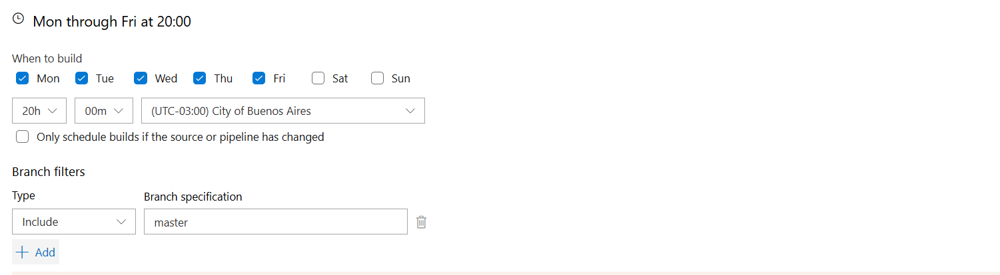
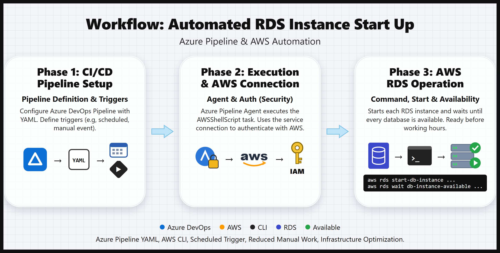

# Automation pipeline: AzurePipeline.RDS.StartUp
This repository includes an Azure pipeline designed to automate the process of starting and managing an RDS instance on AWS. It contains commands to launch an RDS instance, monitor its health, and efficiently manage its lifecycle. This configuration helps simplify infrastructure management, reduce manual work, and ensure that instances start and verify reliably within deployment workflows.

### 🛠️For the use the schema
* Aws account and a RDS
* Azure devOps account
* * Install the [AWS Toolkit for Azure DevOps](https://marketplace.visualstudio.com/items?itemName=AmazonWebServices.aws-vsts-tools) extension
* * Create an AWS service connection
* * Create new pipeline
* * Set the variables in azure-pipelines.yml

#### AWS service connection
The pipeline uses the `AWSShellScript@1` task, which authenticates through an Azure DevOps service connection instead of access keys stored in variables.

- Go to **Project Settings → Service connections → New service connection → AWS**
- Enter the Access Key ID and Secret Access Key (or a Role ARN to assume)
- Name it `aws-dev-connection` (or update `awsCredentials` in azure-pipelines.yml to match)

#### Pipeline variables
Defined directly in azure-pipelines.yml:

```yaml
variables:
  AWS_REGION: 'us-east-1'
  AWS_INSTANCE_ID: 'database-1,database-2'
```

Replace them with your actual region and RDS DB instance identifiers. `AWS_INSTANCE_ID` accepts one identifier or several separated by commas; the pipeline starts them one by one, since `aws rds start-db-instance` takes a single identifier per call.

After starting the instances, the pipeline runs `aws rds wait db-instance-available` for each one, so the run only succeeds once every database is available.

### ⚡Triggers in Azure Devops
We can configure pipelines to run on the days we need:
- Create pipeline in Azure Devops
- Setting pipeline with this repository and azure-pipelines.yml
- Select Triggers and Scheduled
- Scheduled detail:

<div align="center">
  
</div>

### 🔄 Workflow
Pipeline workflow overview:

<div align="center">
  
</div>
